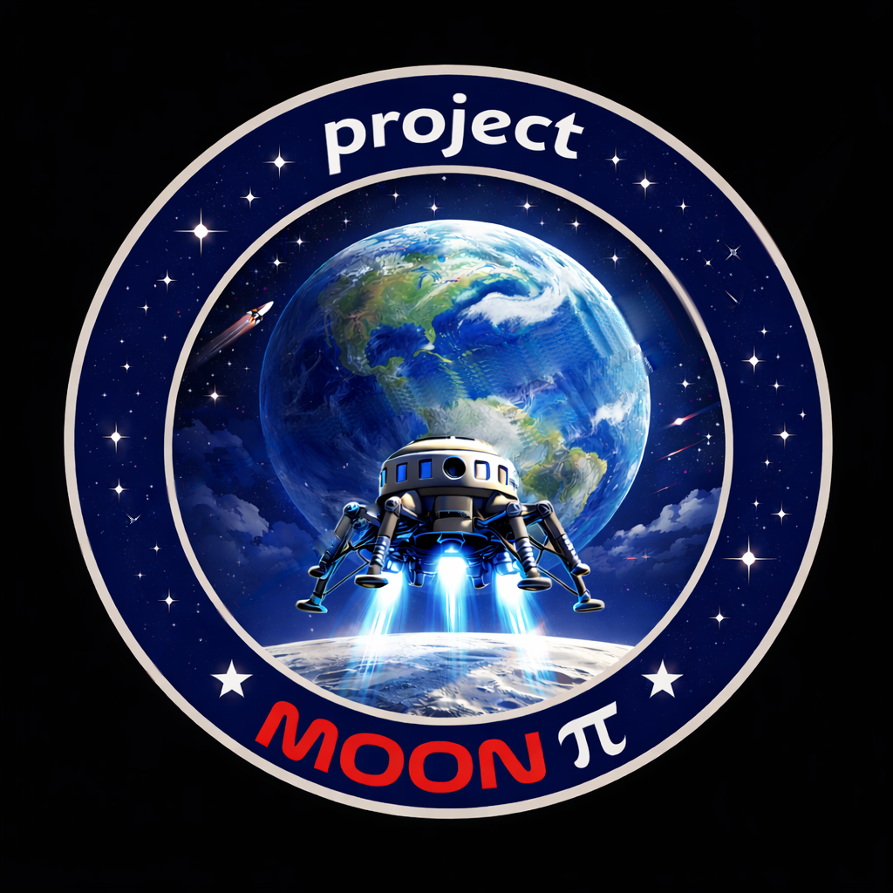

<b>Designed and Created by Project Moon Pi</b> <a href="https://ProjectMoonPi.com">ProjectMoonPi.com</a>

# M.O.S.S. downloads

**M.O.S.S.** (Maintenance, Operations, and Service System) is a digital instrument panel for a classic skid steer,
on a Raspberry Pi: gauges, alarms, maintenance reminders and a service web page. This is where its signed releases
and guides are published.

## Download

| What | File |
|---|---|
| **Make a Pi's card** (Mac) | **[MOSS-SD-Card-Creator](https://github.com/projectmoonpi/moss-releases/releases/latest)**: puts Raspberry Pi OS and M.O.S.S. on a microSD card, set up for your Wi-Fi |
| **Update a dash** | **[MOSS-&lt;version&gt;.zip](https://github.com/projectmoonpi/moss-releases/releases/latest)**: the signed software |
| **The User and Installation Guide** | **[MOSS-guide-screen.pdf](https://github.com/projectmoonpi/moss-releases/releases/latest/download/MOSS-guide-screen.pdf)** (for reading on a screen) · [print version](https://github.com/projectmoonpi/moss-releases/releases/latest/download/MOSS-guide.pdf) |
| **The Board Assembly Guide** | **[MOSS-assembly-guide-screen.pdf](https://github.com/projectmoonpi/moss-releases/releases/latest/download/MOSS-assembly-guide-screen.pdf)** · [print version](https://github.com/projectmoonpi/moss-releases/releases/latest/download/MOSS-assembly-guide.pdf) |

The newest release and the two before it are kept on the [Releases page](https://github.com/projectmoonpi/moss-releases/releases),
in case a new release has a problem with your machine. **The newest is the one to use.**

## Make a card

1. Download **MOSS-SD-Card-Creator-&lt;version&gt;.zip** and double-click it to unzip.
2. Open **M.O.S.S. RPi SD Card Creator**. The first time, macOS may say it can't check it for malicious software:
   click **Done**, open **System Settings › Privacy & Security**, scroll down and click **Open Anyway**.
3. Follow its pages. It checks the Mac first and walks you through anything that needs fixing, then makes the card.

The card gets the newest M.O.S.S. (recommended) unless you choose one of the two before it on the card creator's
**Which version of M.O.S.S.?** page, and the Raspberry Pi OS that version has been tested on (named in each
release), unless you choose a newer one.

## Update a dash

Download **MOSS-&lt;version&gt;.zip** and **don't unzip it**: it carries its signature inside, and a dash installs only
a release that's signed and unchanged.

- **From the dash's web page:** join the dash's SERVICE WI-FI, open its web page, **Software**, and upload the zip.
- **From a USB stick** (dashes on 2.5.7 or newer): put the zip in the stick's top folder and plug it into the dash.
  Dashes on 2.5.6 or older: use the web page.

## For software: latest.json

[`latest.json`](latest.json) names the newest release, its files, their SHA-256 and the Raspberry Pi OS it's tested
on, and lists the releases kept (`versions`: the newest and the two before it). The SD Card Creator reads it to fetch the newest release when it has none, or an older one. Whatever it fetches is
still checked against the project's signing key before it goes on a card.

## Credits

**Designed and Created by Project Moon Pi.** Built with **Claude Code (Anthropic)**: designed, written and tested in
partnership with Claude, an AI model made by Anthropic. M.O.S.S. stands on the work of many others:

| What | Who | Licence |
|---|---|---|
| [Raspberry Pi](https://www.raspberrypi.com), [Raspberry Pi OS](https://www.raspberrypi.com/software/) and [Raspberry Pi Imager](https://github.com/raspberrypi/rpi-imager) | Raspberry Pi Ltd | Debian licences; Apache 2.0 |
| [Python](https://www.python.org) and [pygame](https://www.pygame.org) | Python Software Foundation; the pygame community | PSF; LGPL |
| [KiCad](https://www.kicad.org) and [Freerouting](https://github.com/freerouting/freerouting) | KiCad developers; Freerouting team | GPL |
| [CadQuery](https://cadquery.readthedocs.io) | CadQuery contributors | Apache 2.0 |
| [ReportLab](https://www.reportlab.com) | ReportLab Inc. | BSD |
| [B612](https://github.com/polarsys/b612) and [Orbitron](https://github.com/theleagueof/orbitron) typefaces | Airbus, Intactile Design; Matt McInerney | SIL Open Font License |
| [Adafruit](https://www.adafruit.com) and [SparkFun](https://www.sparkfun.com) modules and open designs | Adafruit Industries; SparkFun Electronics | Open hardware; CC BY-SA 4.0 |
| [Leaflet](https://leafletjs.com), [OpenStreetMap](https://www.openstreetmap.org/copyright) tiles, Esri World Imagery | Volodymyr Agafonkin; OpenStreetMap contributors; Esri | BSD 2-Clause; ODbL; Esri terms |
| [VSCO 2 Community Edition](https://github.com/sgossner/VSCO-2-CE), [Big Sound Bank](https://bigsoundbank.com), [University of Iowa EMS](https://theremin.music.uiowa.edu/MIS.html) | Versilian Studios; Joseph Sardin; University of Iowa | CC0; CC0; free for any use |
| The machine's and engine's service manuals | Their authors | Reference |

The guide's acknowledgements say more.

M.O.S.S. and Project Moon Pi are not affiliated with, or endorsed by, any skid steer or engine maker; their names
are used only to say what M.O.S.S. fits.

## Licence

MIT (see [LICENSE](LICENSE)). **No warranty:** a hobby project for an old machine. Check everything yourself before
you wire it to a machine you care about.
